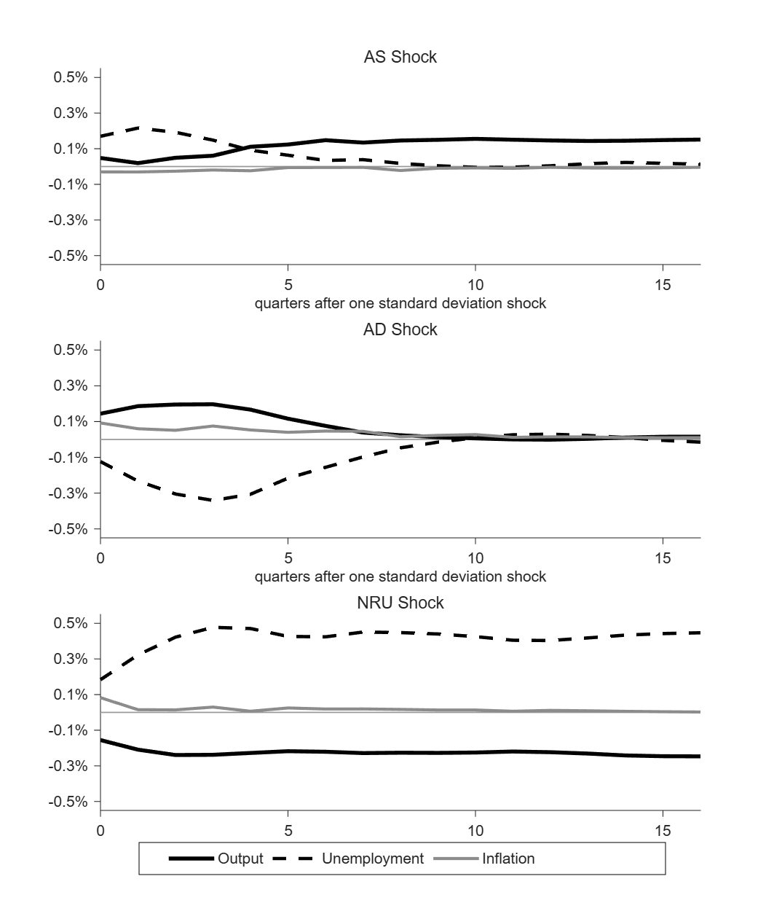
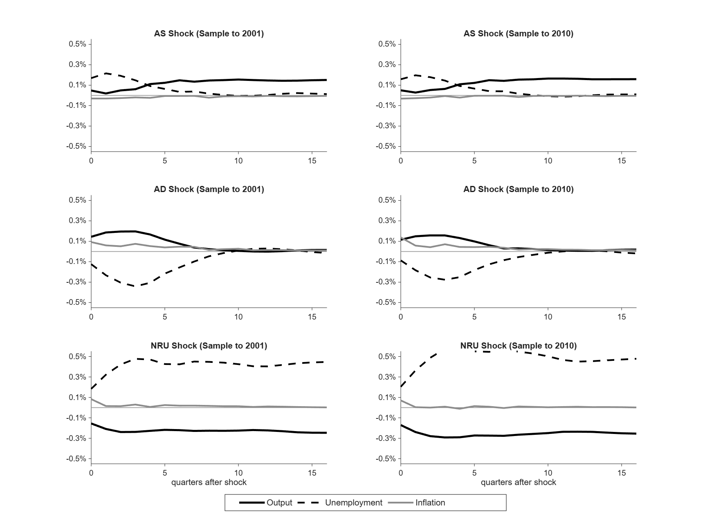
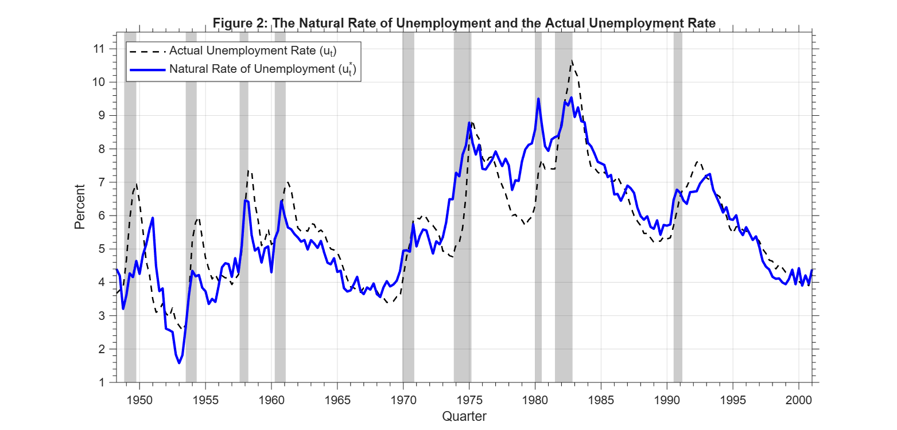
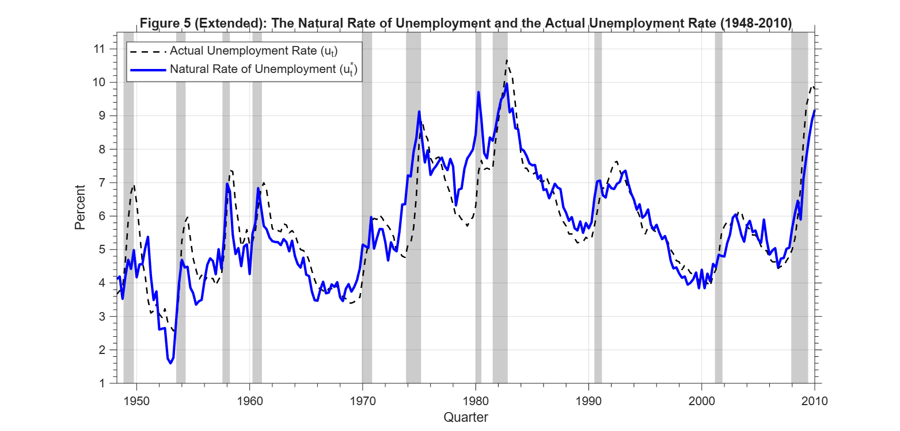

# Structural VAR Replication & Extension: Natural Rate of Unemployment

MATLAB and Python econometric replication and sample extension of **Robert G. King & James Morley (2007)**, *"In Search of the Natural Rate of Unemployment"*, *Journal of Monetary Economics*, 54(2), 550–564.

## Overview & Econometric Methodology
- **Baseline Replication (1948Q2 – 2001Q1) & Post-2001 Extension:** Estimates the time-varying equilibrium natural rate of unemployment (NAIRU) using **Structural Vector Autoregressions (SVAR)** identified via **Blanchard–Quah long-run restrictions** and Beveridge–Nelson multivariate trend-cycle decompositions.
- **Bayesian VAR Forecasting (`BN_BVAR`):** Evaluates out-of-sample Root Mean Squared Error (RMSE) forecasting performance against univariate AR benchmarks.
- **Structural Diagnostics:** Computes Impulse Response Functions (`IRFs`), Forecast Error Variance Decompositions (`FEVDs`), unit-root stationarity tests (ADF, Phillips–Perron), and empirical Phillips Curve dynamics across US FRED macroeconomic series.

---

## Visual Highlights

### Baseline Replication vs. Extended Sample Estimates
| Replication: Unemployment & Natural Rate | Comparison: 2001 vs. Extended Sample |
| :---: | :---: |
|  |  |

| Structural Impulse Responses (Baseline) | Structural Impulse Responses (Extended) |
| :---: | :---: |
|  |  |

---

## Repository Structure

```text
├── MAIN.m                        # Master driver estimating baseline & extended SVAR models
├── _func/                        # Econometric routines (LR_restriction, BN_BVAR, IRF/FEVD, OLS/ADF)
├── other_scripts/                # Scripts & CSV outputs for Figures 1–6 and Tables 1–2
├── datasets/                     # FRED macroeconomic series & Python Data Retrieve notebook
└── assets/                       # Generated replication and extension figures
```

## How to Run
Open MATLAB in the repository root and run:
```matlab
MAIN
```
All figures and summary tables in `other_scripts/` regenerate automatically.
